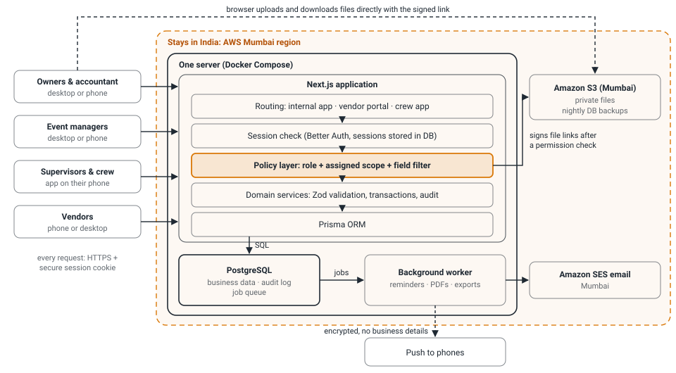
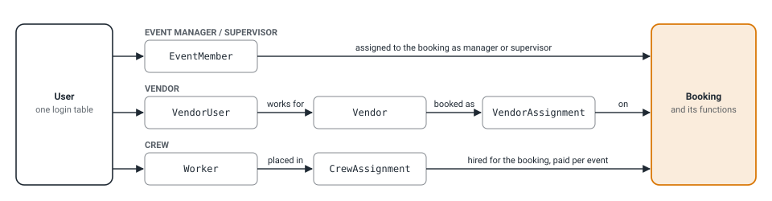

# Event Management ERP: Requirements, Architecture & Roadmap

**Status:** v1.1, **approved by the owners on 17 Nov 2026** · **Phase:** 1 (Requirements) and 2 (Architecture) · **Date:** 17 Nov 2026

This is the plan for the internal system. Nothing has been built yet. Section 3 records your answers and what each one changed. Phase 3 (screen designs) is under way.

---

## 1. What I understood

You run an event management company (weddings, pre-wedding shoots, cocktail parties, birthdays and other celebrations). Today the work with vendors and labour runs over phone calls and WhatsApp. You want **one internal system** where every booking is planned, staffed, executed and settled. Each person logs in with their own account and sees only what they are allowed to see. It is an internal operations tool. It is **not** a booking app, and **clients don't use it**.

**Who uses it**

| Role | Who they are | What they mainly do in the app |
|---|---|---|
| Owner | Founder and co-founder (equal, full access) | See everything, approve quotes and payments, control who can do what |
| Event Manager | Runs the bookings assigned to them | Plans functions, books vendors, builds the crew, sets schedules and tasks, records expenses. Never sees client billing or margin. |
| Accountant | Handles the books | Client billing, vendor invoices, payments, GST records, exports for your outside accountant |
| Supervisor | On site at the venue | Runs the event day: run sheet, crew attendance, task sign-off, proof photos |
| Vendor | Caterers, decorators, photographers, DJs, tent houses… | Get requirements, submit quotes, accept work, upload invoices, upload **photos and videos of completed work**, track payments |
| Labour | Your own crew, paid per event | See assigned events, reporting time and place, duties; mark tasks done; upload **photos and videos of completed work** |

**Clients** are stored as records (name, phone, GST details, invoices and payments) but have no login.

**The lifecycle the system covers**

1. **Booking:** an event is created as *Tentative* with its client and one or more **functions** (for example Haldi, Sangeet and Wedding, or just a single cocktail party).
2. **Planning:** requirements are listed per function, vendors are asked for quotes, an owner approves a quote, and a work order goes to the vendor. The crew is assigned and the budget is set.
3. **Event day(s):** the supervisor runs the schedule, vendors report on time, crew attendance is marked, and vendors and crew upload photos and videos of finished work, which the supervisor or manager approves.
4. **Closure:** vendors upload invoices, crew pay is confirmed, and the client's balance is collected.
5. **Settlement:** everyone is paid, the booking's profit and loss is final, and its records are locked.

---

## 2. Features beyond the original brief

These were proposed in v0.1 and adjusted after your answers.

### In v1

| # | Feature | Why it matters |
|---|---|---|
| G2 | **Bookings with one or more functions** | A booking can be a single cocktail party or a five-function wedding. Vendors, crew shifts and the run sheet attach to the specific function. |
| G3 | **Assignment-based access** on top of roles | Managers and supervisors see only *their* bookings. Vendors see only *their* work. Labour see only *their* events. |
| G4 | **One approvals inbox for the owners** | Quotes, payments and expenses wait in one list. Either owner can approve. |
| G5 | **Financial records that can't be deleted** | Payments and invoices are corrected with a void or reversal plus a reason, never deleted. Your accountant can trust the trail. |
| G6 | **GST-ready records** | Your GSTIN on documents, vendors' GSTINs, tax split on invoices, gap-free numbering, and GST-friendly exports for your accountant. |
| G7 | **Phone-number logins** | Labour and most vendors log in with their mobile number and a password or PIN. Owners can reset it. |
| G11 | **Task and checklist templates** per event type | "New wedding" creates your standard checklist automatically. |
| G13 | **Encrypted bank and ID details** | Only owners and the accountant can see them. |
| G18 | **iPad as a first-class device** (your request, 17 Nov) | Every screen is designed at three sizes: phone, iPad (portrait and landscape) and desktop. On iPad: two-pane layouts, 44 px touch targets, no hover-only actions, keyboard shortcuts with a Magic Keyboard, and install from Safari's "Add to Home Screen" with push notifications (iPadOS 16.4+). |
| G17 | **Photo and video proof of completed work** (your request, 17 Nov) | Vendors and crew record proof straight from their phone camera. Each item is time-stamped and approved or rejected by the manager or supervisor. Owners and the accountant can check it before paying. See "Work proof" in section 4. |
| G15 | **Import from Excel and contacts** | So day one isn't hours of typing. |
| G16 | **Automatic backups (kept in India) and full export** | It's your data; you can always take it out. |

### Dropped after your answers

- **G1 Enquiry pipeline and client proposals:** dropped, since this is internal, not a booking app. An event simply starts as *Tentative*.
- **Client/host portal:** dropped, since clients don't use the app.
- **G8 Multi-company design:** dropped, since this is for your company only. This simplifies every query.
- **G10 Labour contractors:** dropped, since you hire labour directly.
- **G14 Hindi screens:** dropped, since your crew uses English. Text is kept in one place, so another language can be added later.

### Later (after launch)

WhatsApp Business notifications · online client payments (UPI links) · owned-inventory tracking (if you own equipment, see open question 7) · offline mode for venues with poor network · native mobile app.

---

## 3. Your answers and what they changed

| # | Question | Your answer | What it changes |
|---|---|---|---|
| 1 | SaaS or single business? | Only for you | Single-company design; one company profile; no per-company filtering. |
| 2 | Founder vs co-founder, other roles | Both full owners; also managers, accountant, on-site supervisor | Roles: **Owner, Event Manager, Accountant, Supervisor** (plus Vendor and Labour). |
| 3 | Who is the "host"? | You are; clients don't need the app | No client portal. Clients are records only. |
| 4 | Functions | One booking, one or many functions | Event → Functions. Single-function bookings hide the extra layer in screens. |
| 5 | Margin | Managers don't see margin | Managers never see client billing, margin or company totals. |
| 6 | Labour | Smartphones, English, hired directly, paid per event | Labour app in English; pay is a fixed amount per event (plus approved extras); no contractor layer. |
| 7 | Vendors | They will log in for quotes and invoices | The vendor portal is a core v1 feature, built in Phase 6. |
| 8 | Tax | GST-registered; outside accountant | GST fields and numbering; exports for the accountant (sales and purchase registers, payments). |
| 9 | Approvals | Founder and co-founder approve | Owners approve quotes, payments and expenses. Managers and the accountant prepare; owners decide. |
| 10 | Hosting | Data must stay in India: Option B | One server in **AWS Mumbai**, files and backups in AWS Mumbai storage. No services that store your business data abroad. |
| 21 | GitHub | Repository `taamaraAPP` created | All plans and code are pushed to `Harshith993/taamaraAPP`. |
| — | New request | A very immersive UI that doesn't look AI-generated; iPad users too | Phase 3 starts with three genuinely different visual directions drawn on a real screen. You pick one before the full design. Every screen is designed for phone, iPad and desktop (G18). |
| — | New request | Vendors and labour upload photos or videos of completed work | New work-proof feature (G17): camera upload in the vendor portal and crew app, review by manager or supervisor, video processing on the server, more storage. Built in Phase 6. |

### Assumptions (all confirmed by the owners, 17 Nov)

- **A1.** Either owner can approve on their own; both signatures are not required.
- **A2.** Managers can see vendor quotes and crew pay for *their* bookings, so they can plan within budget. They never see what the client is charged. The owner can switch this off.
- **A3.** Crew pay is one agreed amount per event. Extras (late night, extra day) or deductions are added as separate lines, which an owner approves.
- **A4.** Event managers can create bookings; owners can too.

### Still open (answer any time before the phase noted)

1. ✅ **Answered:** the company and the app are **Taamara Taamara** (events & beyond). The colours come from the company logo; see `docs/design/DESIGN-LANGUAGE.md`.
2. **Client billing:** should the app generate GST tax invoices to clients, or does your accountant raise them while the app only records client payments? Do you deduct TDS on vendor payments? *(Phase 7)*
3. **Accountant:** an employee, or your outside accountant logging in? *(Phase 5)*
4. **Attendance:** does the supervisor mark it, or does the crew check in on their phone at the venue (with location)? *(Phase 6)*
5. **Should crew see their pay** and payment status for each event? *(Phase 6)*
6. **Cash advances:** do managers or supervisors carry company cash for on-site spending? *(Phase 7)*
7. **Equipment:** do you own decor, furniture, lights or sound that moves between events? *(Phase 6)*
8. **Scale:** events per month, the busiest single day, and roughly how many vendors, crew and managers? *(Phase 4)*
9. **Launch timing:** pilot on a few small events during the season, or switch over after it? *(Phase 10)*
10. ✅ **Answered:** defaults approved. Proof can come from the camera or the gallery, videos can be up to 2 minutes, and a vendor's final payment needs approved proof.

---

## 4. Architecture

**A single well-organised application (a "modular monolith") on one server in Mumbai.** One codebase serves the internal app, the vendor portal and the crew app. Each person's screens depend on who they are.



### Stack

| Layer | Choice | Why |
|---|---|---|
| App framework | **Next.js (App Router) + React + TypeScript** | One codebase for every role. Fast pages on phones. Type checking catches mistakes before users do. |
| UI | **Tailwind CSS + shadcn/ui** (Radix), TanStack Table, Recharts, lucide icons | Accessible building blocks we own, styled to look premium, with light and dark mode. |
| Backend shape | **Modular monolith**: one module per area (events, vendors, crew, tasks, finance…), each with its own service, policy and validation. REST API under `/api/v1`. | One deployment, easy to reason about. A future mobile app can reuse the API. |
| Validation | **Zod**, shared by forms (React Hook Form) and the API | The same rules in the browser and on the server. |
| Database | **PostgreSQL 16** | Relational data and safe transactions for money. |
| ORM | **Prisma** with `prisma migrate` | Typed queries, versioned migrations, seed scripts. |
| Money | `NUMERIC(14,2)` in the database, a decimal library in code | Never floating point, so no lost paise. |
| Authentication | **Better Auth** (self-hosted, sessions in our database) | Phone or email plus password/PIN, revocable sessions, rate limiting, two-factor for owners. Nothing leaves your server. |
| Authorization | **Our own policy layer**: `can(user, action, record)`, scoped query filters, per-role response shapes | Expresses "only my bookings" and "never show margin", with tests for every role. |
| Files | **Amazon S3 in Mumbai** (private bucket) | The browser uploads directly through short-lived signed links. Downloads use signed links issued only after a permission check. File type and size are checked; photos are compressed on the phone first. Videos upload in chunks, so a dropped connection resumes instead of starting over. |
| Media processing | **ffmpeg** in the background worker | Makes thumbnails and converts phone videos (including iPhone HEVC) into a small MP4 that plays on any phone or browser. The original is kept. |
| Background jobs | **pg-boss** (queue inside Postgres) | Deadline reminders, overdue checks, notifications, PDF and Excel generation. No extra service to run. |
| Live updates | Server-Sent Events from our own server, with a 30 s refresh as fallback | Live notification and chat updates with no third-party realtime service, so data stays in India. |
| Notifications | In-app + web push to phones + email (Amazon SES, Mumbai) | Push payloads are end-to-end encrypted and carry no business details. WhatsApp is listed under Later. |
| Documents out | `@react-pdf/renderer` for work orders, invoices and run sheets; `exceljs` for exports | Consistent PDFs and accountant-friendly Excel. |
| Quality | Vitest (unit tests and a full permission-matrix test), Playwright (end-to-end per role), GitHub Actions CI | Every role is tested against every action on every change. |
| Monitoring | Error and request logs kept on the server, an uptime check, a daily health email | No error-tracking service that stores data abroad. |

### Hosting (Option B, data in India)

| Piece | Where | Notes |
|---|---|---|
| Server | AWS Lightsail (or EC2) in **Mumbai**, 4 GB RAM to start | Docker Compose runs the app, PostgreSQL, the job worker and Caddy (automatic HTTPS). Automatic security updates. |
| Files | Amazon S3, **Mumbai** | Private bucket; versioning on. Photos and videos move to a cheaper storage class after 6 months and are never deleted automatically. Storage costs roughly US $2–3 per month per 100 GB, plus a little for viewing. |
| Backups | Nightly database backup to a separate S3 bucket in **Mumbai**, kept 30 days; weekly server snapshot | A restore drill is part of Phase 9. |
| Email | Amazon SES, **Mumbai** | Password resets, reminders, daily summary. |
| Code | Private GitHub repository | Code only. No real business data ever goes into the repository. |
| Rough cost | About US $20–35/month at your scale, plus media storage as it grows | Confirmed before Phase 10. You'll need an AWS account in the company's name. |

Keeping everything with one provider in one region means one bill, one place for data, and simpler upkeep. I'll provide a short runbook for routine care: checking backups, restarting, and updating.

### Work proof (photos and videos of completed work)

This is how the feature works end to end:

1. **Capture.** In the vendor portal or crew app, the person opens their task, vendor booking or shift and taps **Add proof**. The phone camera opens directly, and they can also pick from the gallery unless you turn that off. Several photos and videos can be added at once, with an optional caption.
2. **Upload.** Photos are resized on the phone (about 2–3 MB each) before sending. Videos are sent in chunks with a progress bar. If the venue network drops, the upload resumes from where it stopped while the app is open. The default limit is 2 minutes or about 500 MB per video, which owners can change.
3. **Stamp.** The server records who uploaded it, when, for which booking and function, and the phone's location if the person allows it. This shows the work was done at the venue on the day.
4. **Process.** The background worker makes a thumbnail and a small, universally playable MP4 copy. People see a placeholder until it's ready, usually within a minute.
5. **Review.** The booking's manager or supervisor gets a notification and approves or rejects each item with a note. A rejection asks the vendor or crew member to re-upload.
6. **Pay.** Owners and the accountant see the approved proof next to a vendor's invoice before approving payment. By default, a vendor's final payment needs approved proof (open question 10).

**Who sees it:** owners see all proof. The booking's manager and supervisor see proof for their bookings. Each vendor and crew member sees only their own uploads. Files are never public: every view uses a link that expires after a few minutes.

**Checks:** the file type is verified from its content, not its name. Size limits are enforced by the signed upload link itself. Location metadata is removed from the viewing copies.

### Code layout

```text
src/
  app/
    (auth)/          login, first-time password, reset
    (internal)/      dashboard, events/[id]/…, vendors, crew, tasks, finance, approvals, reports, team, settings
    (vendor)/        vendor portal
    (crew)/          crew app (installable on phones)
    api/v1/          REST endpoints, thin: auth → policy → service
  modules/
    events/  vendors/  crew/  tasks/  finance/  approvals/  documents/  comms/  notifications/  identity/  audit/
      service.ts      business rules and transactions
      policy.ts       who may do what, and query scope
      schemas.ts      Zod input rules
      serializers.ts  what each role is allowed to see
  components/        ui/ (shadcn) and shared building blocks
  lib/               db, auth, storage, jobs, money, errors, rate-limit
prisma/              schema.prisma, migrations/, seed.ts
tests/               unit/, permissions/, e2e/
deploy/              docker-compose.yml, Caddyfile, backup scripts, runbook
docs/                this document, progress tracker, decisions log
```

---

## 5. How access control works

Permissions are checked in three layers, all **on the server**. Hiding a button in the browser is only for convenience, never for security.

1. **Account type.** Each account is `INTERNAL`, `VENDOR` or `LABOUR`, which decides which app the person can open. A vendor account can never open internal pages.
2. **Role permissions.** Each permission is written as `area.action` with a scope: **all**, **assigned** or **own**. Owners can adjust what Managers, the Accountant and Supervisors may do. The Owner role itself always has everything.
3. **Record scope and field visibility.** Every query is filtered by the person's links to a booking (diagram below). Every response is built by a serializer for that role, which lists the fields allowed. For example, a manager's view of a booking simply has no client-billing fields.



**Also built in:**

- Preparer and approver are separate for money: managers and the accountant prepare payments and expenses, and owners approve them.
- An append-only audit log of every change: who, what, before and after, when, and from which IP address.
- Two-factor login for owners.
- Rate limits and lockout on login.
- Any session can be signed out remotely (for example, from a lost phone).

---

## 6. Role–permission matrix (v1.1)

**Key:** **All** = every record · **Assigned** = only bookings they are assigned to · **Own** = only their own records · **View** = read-only · **⚙** = the default shown; owners can switch it · **—** = no access

<div class="matrix">

| Capability | Owner (Founder & Co-founder) | Event Manager | Accountant | Supervisor | Vendor | Labour |
|---|---|---|---|---|---|---|
| **Bookings & planning** | | | | | | |
| See bookings and functions | All | Assigned | View | Assigned | Assigned | Assigned |
| Create bookings | Yes | Yes | — | — | — | — |
| Edit booking details and functions | All | Assigned | — | — | — | — |
| Assign managers and supervisors | Yes | — | — | — | — | — |
| Cancel booking | Yes | — | — | — | — | — |
| Delete booking (only if no money recorded) | Yes | — | — | — | — | — |
| Schedule and run sheet | All | Assigned | View | Assigned | Own | Own |
| Requirements per function | All | Assigned | View | View | Own | — |
| Client contact details | All | Assigned | All | ⚙ Assigned | — | — |
| **Tasks** | | | | | | |
| Create and assign tasks | All | Assigned | — | ⚙ Assigned | — | — |
| Update own tasks | Own | Own | Own | Own | Own | Own |
| **Work proof (photos & videos)** | | | | | | |
| Upload photos or videos of completed work | Yes | Assigned | — | Assigned | Own | Own |
| See work proof | All | Assigned | ⚙ View | Assigned | Own | Own |
| Approve or reject proof | All | Assigned | — | Assigned | — | — |
| Approve completed work | All | Assigned | — | Assigned | — | — |
| **Vendors** | | | | | | |
| Vendor directory | All | View | View | View | Own | — |
| Add and edit vendors | Yes | ⚙ Add | — | — | Own | — |
| Vendor bank and GST details | Yes | — | Yes | — | Own | — |
| Request quotations | All | Assigned | — | — | — | — |
| Submit quotations and invoices | Yes | — | Yes | — | Own | — |
| See quotation amounts | All | ⚙ Assigned | All | — | Own | — |
| Approve quotations | Yes | — | — | — | — | — |
| Accept or decline work | — | — | — | — | Own | — |
| Issue work orders | Yes | ⚙ Assigned | — | — | — | — |
| Rate vendors | Yes | Assigned | — | Assigned | — | — |
| **Crew (labour)** | | | | | | |
| Crew directory | All | View | View | View | — | Own |
| Register and edit crew | Yes | Yes | — | ⚙ Add | — | Own |
| Assign crew to bookings and shifts | All | Assigned | — | — | — | — |
| Mark attendance | All | Assigned | — | Assigned | — | ⚙ Own |
| Per-event pay rates | All | ⚙ Assigned | All | — | — | ⚙ Own |
| **Money** | | | | | | |
| Company revenue, expenses, P&L | Yes | — | Yes | — | — | — |
| Client billing and margin | Yes | — | Yes | — | — | — |
| Booking budget (costs, estimate vs actual) | All | ⚙ Assigned | All | — | — | — |
| Record expenses with receipts | Yes | Assigned | Yes | ⚙ Assigned | — | — |
| Record client payments | Yes | — | Yes | — | — | — |
| Approve payments and expenses | Yes | — | — | — | — | — |
| Mark approved payments as paid | Yes | — | Yes | — | — | — |
| Payment status | All | ⚙ Assigned | All | — | Own | ⚙ Own |
| Reports and exports for the accountant | Yes | — | Yes | — | — | — |
| **Documents & communication** | | | | | | |
| Booking documents | All | Assigned | View | Assigned | Shared | Shared |
| Upload documents | Yes | Assigned | Yes | Assigned | Own | Own |
| Owner-only confidential documents | Yes | — | — | — | — | — |
| Booking team chat | All | Assigned | — | Assigned | — | — |
| Direct threads | All | Assigned | ⚙ Own | Assigned | Own | Own |
| Send announcements | All | Assigned | — | Assigned | — | — |
| **Administration** | | | | | | |
| Users, roles and this matrix | Yes | — | — | — | — | — |
| Settings (lists, company, GST, numbering) | Yes | — | ⚙ GST & numbering | — | — | — |
| Audit log | Yes | — | ⚙ Financial | — | — | — |
| Operations reports | All | Assigned | — | — | — | — |

</div>

Notes on the matrix:

- "Submit quotations and invoices" by an owner or the accountant means entering a document on a vendor's behalf, for vendors who send it on paper.
- "Delete" applies only to records with no money attached. A booking with payments is cancelled, and payments are voided with a reason (G5).
- Labour "Own" for attendance means self check-in, which depends on open question 4. Labour "Own" for pay depends on open question 5.

**Hard rules (built into the server's responses, not just hidden on screen):**

- **Event Managers never see** client billing, margin, company totals, vendor bank details, or bookings they aren't assigned to.
- **Supervisors never see** client billing, vendor quotes, or anyone's pay.
- **Vendors never see** other vendors or their quotes, client details, budgets or crew pay. Their on-site contact is your manager or supervisor.
- **Labour never see** client details, budgets, vendor information or other people's pay. Their own pay is shown only if you allow it.

---

## 7. Database design

**Conventions:**

- Every table has `id` (UUID), `created_at`, `updated_at` and `created_by`.
- Master data (vendors, crew, clients) is soft-deleted with `deleted_at`.
- Money is `NUMERIC(14,2)`.
- Times are stored in UTC and shown in Asia/Kolkata.
- Statuses are enums.
- Documents get readable, gap-free numbers (`EVT-2026-0042`, `PO-2026-0117`, `INV-2026-0089`).

About 46 tables in 11 modules. Key fields are listed below; the full Prisma schema is written in Phase 4.

### Company, identity & access

| Table | Key fields |
|---|---|
| `CompanyProfile` | legal name, GSTIN, PAN, address, state (for GST), logo, bank details for invoices (single row) |
| `User` | name, phone, email?, password hash, account type (INTERNAL / VENDOR / LABOUR), status, 2FA, must-change-password, last login |
| `Session`, `Account`, `Verification` | Managed by Better Auth |
| `Role` / `RolePermission` | role name; permission key + scope (ALL / ASSIGNED / OWN) |
| `UserRole` | user ↔ role (Owner, Event Manager, Accountant, Supervisor, Vendor, Labour) |
| `AuditLog` | actor, action, record type and id, before (JSON), after (JSON), IP, time. Append-only. |

### Clients

| Table | Key fields |
|---|---|
| `Client` | individual or company, name, phone, email, address, GSTIN, state |
| `ClientContact` | client, name, relation (for example, bride's father), phone. A record only, with no login. |

### Bookings

| Table | Key fields |
|---|---|
| `EventCategory` | name, colour, default checklist template (configurable) |
| `Venue` | name, address, city, map link, contact, capacity (reusable) |
| `Event` (booking) | code, name, category, client, status (TENTATIVE → CONFIRMED → PLANNING → LIVE → COMPLETED → SETTLED; or POSTPONED / CANCELLED), dates (derived from functions), description |
| `EventFunction` | event, name (Haldi, Sangeet, Cocktail…), date, start and end time, venue, expected guests, notes |
| `EventMember` | event, user, role on booking (MANAGER / SUPERVISOR). **This drives "Assigned" access.** |
| `Requirement` | event, function, category, description, quantity, status, linked vendor assignment |
| `ScheduleItem` | event, function, start and end, type (SETUP / VENDOR_REPORTING / CREW_REPORTING / CEREMONY / DISMANTLE / DEADLINE), location, responsible person, visible to (INTERNAL / VENDORS / CREW) |

### Vendors

| Table | Key fields |
|---|---|
| `VendorCategory` | configurable list (Catering, Decoration, Photography, Videography, Lighting, Sound, Stage, Transport, Security, Equipment rental, Entertainment, Other) |
| `Vendor` | contact name, company, categories, services, phone, email, city, GSTIN, PAN, status (ACTIVE / INACTIVE / BLACKLISTED), average rating |
| `VendorUser` | vendor ↔ user (a vendor can have several logins) |
| `VendorBankDetail` | account name, account number (encrypted), IFSC, UPI ID |
| `VendorRateCard` | item, unit, rate |
| `VendorBlackout` | dates the vendor is unavailable |
| `VendorAssignment` | event, function, vendor, scope of work, reporting time, status (INVITED → QUOTED → APPROVED → ACCEPTED → IN_PROGRESS → DELIVERED → COMPLETED; or DECLINED / CANCELLED) |
| `Quotation` / `QuotationItem` | assignment, version, status (SUBMITTED / REVISION_REQUESTED / APPROVED / REJECTED), subtotal, GST, total, validity, file |
| `WorkOrder` | number, assignment, approved quotation, amount, terms, status (ISSUED / ACKNOWLEDGED / CLOSED / CANCELLED), PDF |
| `VendorInvoice` | vendor, work order, invoice number and date, taxable amount, GST, total, file, status (SUBMITTED / VERIFIED / APPROVED / PART_PAID / PAID / DISPUTED) |
| `ProgressUpdate` | assignment, note, percent complete (photos and videos are `WorkProof` items) |
| `VendorReview` | vendor, event, quality, punctuality, communication (1–5), comment (internal) |

### Crew (labour)

| Table | Key fields |
|---|---|
| `Skill` | configurable list (Helper, Decorator, Electrician, Waiter, Driver…) |
| `Worker` | linked user, name, phone, skills, experience, city, usual per-event rate, ID proof, bank/UPI (encrypted), emergency contact, status |
| `WorkerUnavailability` | dates and reason |
| `CrewAssignment` | event, worker, duty, **agreed pay for the event**, status (ASSIGNED / CONFIRMED / DECLINED / COMPLETED / NO_SHOW) |
| `CrewPayAdjustment` | assignment, type (EXTRA / DEDUCTION), amount, reason, approved by |
| `CrewShift` | assignment, function, date, reporting time, location, attendance (PENDING / PRESENT / ABSENT / LATE), check-in time, marked by |

### Tasks

| Table | Key fields |
|---|---|
| `Task` | event?, function?, title, description, priority (LOW / MEDIUM / HIGH / URGENT), status (PENDING / ASSIGNED / IN_PROGRESS / UNDER_REVIEW / COMPLETED / DELAYED / CANCELLED), due date, assignee (any user, including vendors and crew), reviewer, needs approval |
| `TaskComment`, `TaskAttachment` | discussion, reference images and files |
| `WorkProof` | booking, function, **one of** task / vendor assignment / crew assignment, uploaded by, kind (PHOTO / VIDEO), file, caption, uploaded at (server time), location (if allowed), status (PENDING_REVIEW / APPROVED / REJECTED), reviewed by, review note |
| `TaskTemplate` / `TaskTemplateItem` | checklist per event category with relative due dates ("10 days before") |

### Finance

| Table | Key fields |
|---|---|
| `ExpenseCategory` | name, group (VENDOR / LABOUR / TRANSPORT / EQUIPMENT / FOOD / ACCOMMODATION / MISC) |
| `Budget` / `BudgetLine` | event, version; category, description, estimated amount (actuals come from expenses and payments) |
| `ClientCharge` | event, description, amount, GST rate: what the client is billed (package, add-ons). **Hidden from managers.** |
| `ClientInvoice` / `ClientInvoiceItem` | number, event, client, type (ADVANCE / FINAL / ADDITIONAL), CGST / SGST / IGST, total, status, PDF (pending open question 2) |
| `Payment` | direction (IN / OUT), event?, party (client / vendor / worker / other), linked invoice or crew assignment, amount, method (CASH / UPI / BANK / CHEQUE), reference, date, proof, status (PENDING_APPROVAL / APPROVED / PAID / VOIDED), requested by, approved by, void reason |
| `Expense` | event?, category, description, amount, date, paid via, receipt, status (SUBMITTED / APPROVED / REJECTED / REIMBURSED), submitted by, approved by |
| `ApprovalRequest` | type (QUOTATION / PAYMENT / EXPENSE / CREW_ADJUSTMENT), record, requested by, decided by, status, comment |
| `DocumentSequence` | document type, financial year, next number |

### Documents

| Table | Key fields |
|---|---|
| `File` | storage key, filename, type, size, checksum, uploaded by; for media: width, height, duration, thumbnail key, playable-copy key, processing status (UPLOADING / PROCESSING / READY / FAILED) |
| `Document` | event? / vendor? / worker? / task?, kind (CONTRACT / QUOTATION / INVOICE / PLAN / DESIGN / PHOTO / OTHER), title, file, version, visibility (OWNER_ONLY / INTERNAL / BOOKING_TEAM / SHARED) |
| `DocumentShare` | document, shared with (a user, a vendor, or the booking's crew) |

### Communication & notifications

| Table | Key fields |
|---|---|
| `Channel` / `ChannelMember` | event?, type (BOOKING_TEAM / VENDOR_THREAD / CREW / DIRECT); member, last read |
| `Message` | channel, sender, text, attachments, reply to, edited or deleted time |
| `Announcement` / `AnnouncementAck` | audience (all staff, all crew, one booking's team…), title, body, needs acknowledgement; who acknowledged and when |
| `Notification` | user, type, title, link, record, read time |
| `NotificationPreference`, `PushSubscription` | channels per type; phone push endpoints |

---

## 8. Development roadmap

Each phase ends with a demo to you on a test server, passing tests, and an update to `docs/PROGRESS.md`. Effort is indicative for one full-time developer.

| Phase | What gets built | Done when | Effort |
|---|---|---|---|
| **1. Requirements** | v0.1 → v1.0 of this document | You approve v1.0 | ✅ |
| **2. Architecture** | Stack, access model, matrix, schema outline, hosting | You approve v1.0 | ✅ |
| **3. UI/UX** | Three visual directions on the owner's iPad home screen → you pick → sitemap per role; design system (colours, type, light and dark); clickable mockups of the owner dashboard, booking workspace, manager dashboard, supervisor event-day screen, vendor portal and crew app, on phone, iPad and desktop | You approve the look on phone, iPad and desktop | 🔄 started 17 Nov · ~2 wks |
| **4. Database** | Prisma schema, migrations, constraints, audit-log protection, realistic seed data (a full wedding season), repository and CI | Migrations run clean; seed builds a full season | S · ~1 wk |
| **5. Auth & access** | Phone/email login, PIN for crew, first-login password change, sessions, owner 2FA, rate limits, policy layer, team and role screens, permission test suite | Every role passes its matrix tests | M · ~2 wks |
| **6. Core operations** | Booking workspace (overview, functions, schedule and run sheet, requirements, tasks, vendors, crew, documents), calendar, vendor directory, quote → approval → work order, **vendor portal**, crew roster and assignments, attendance, **crew app**, supervisor event-day view, **photo/video work proof with review** | A booking can be planned and run end to end without WhatsApp | L · ~5–6 wks |
| **7. Finance** | Client charges and billing, budgets, expenses with receipts, vendor invoices, payments with owner approval, crew pay and adjustments, outstanding balances, P&L per booking and month, charts, PDF and Excel exports for your accountant | A booking can be settled and its P&L matches your books | L · ~3–4 wks |
| **8. Communication** | Booking team chat, vendor and crew threads, announcements with acknowledgement, in-app + push + email notifications, reminder jobs (deadlines, overdue, schedule changes, approvals waiting) | Booking coordination no longer needs WhatsApp | M · ~2 wks |
| **9. Testing & security** | Permission tests on every endpoint, end-to-end tests per role, OWASP review, upload hardening (photo/video type and size checks), busy-day load test including many video uploads, backup-restore drill | No high-severity issues open | M · ~2 wks |
| **10. Deployment** | AWS Mumbai server, domain, HTTPS, backups, monitoring, data import, one-page guides per role, pilot on 2–3 bookings, go-live | Pilot bookings run fully in the system | M · ~1–2 wks |

**Remaining:** about 18–21 weeks of focused work for one developer. Building with me in working sessions is usually faster; the real limit is review time.

---

## 9. Risks and how we handle them

| Risk | Mitigation |
|---|---|
| Vendors or crew don't use the app | Phone-number login, very simple screens, push notifications. Owners and the accountant can enter quotes and invoices for paper vendors. |
| Rolling out during peak wedding season | Pilot on a few small bookings first; full switch-over in a quieter month. |
| Scope is very large | Strict phases; a "Later" list; nothing ships half-working. |
| Too much typing | Excel import, checklist templates, reusable venues and vendors, sensible defaults. |
| Money figures drift from reality | Records that can't be deleted, voids with reasons, owner approvals, tests on every calculation. |
| Large videos on weak venue networks | Chunked uploads that resume, photos shrunk on the phone, a progress bar, clear size limits. |
| Media storage keeps growing | Cheaper storage class after 6 months, a storage report for owners, limits per video. |
| Single server goes down | Nightly backups in Mumbai, weekly snapshots, a tested restore and a runbook. Recovery to a fresh server in under an hour. |
| A wrong permission leaks data | Server-side policy layer, allow-list responses, and an automated test of the whole matrix on every change. |

---

## 10. Next steps

1. ✅ **Done:** the repository `Harshith993/taamaraAPP` exists and holds this plan.
2. ✅ **Done:** v1.1 approved, along with assumptions A1–A4, the name Taamara and the proof defaults.
3. ✅ **Done:** direction C (Cue Sheet) chosen and recoloured in the Taamara Taamara lotus palette.
4. **You:** confirm the recoloured owner home, design language and crew app, and send the original logo file.
5. **Me:** the full screen set in this style, for phone, iPad and desktop.
